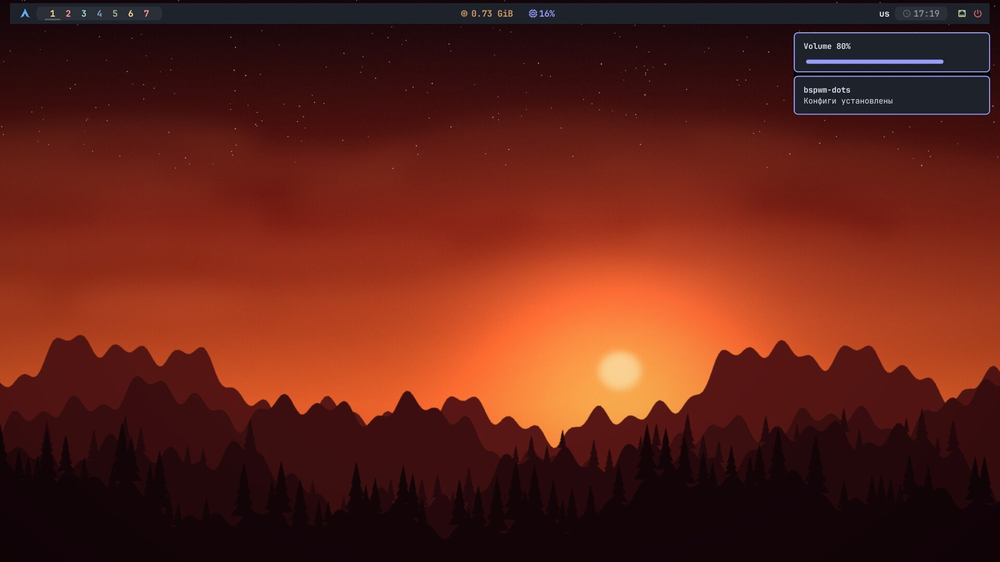
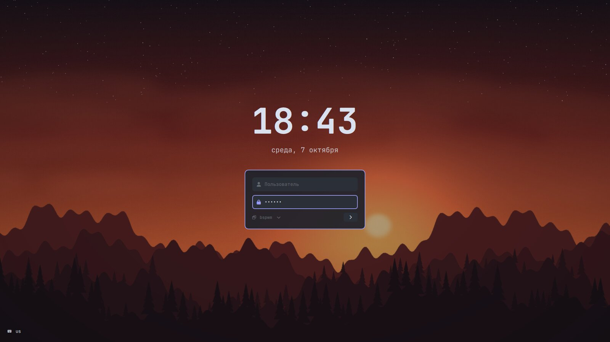
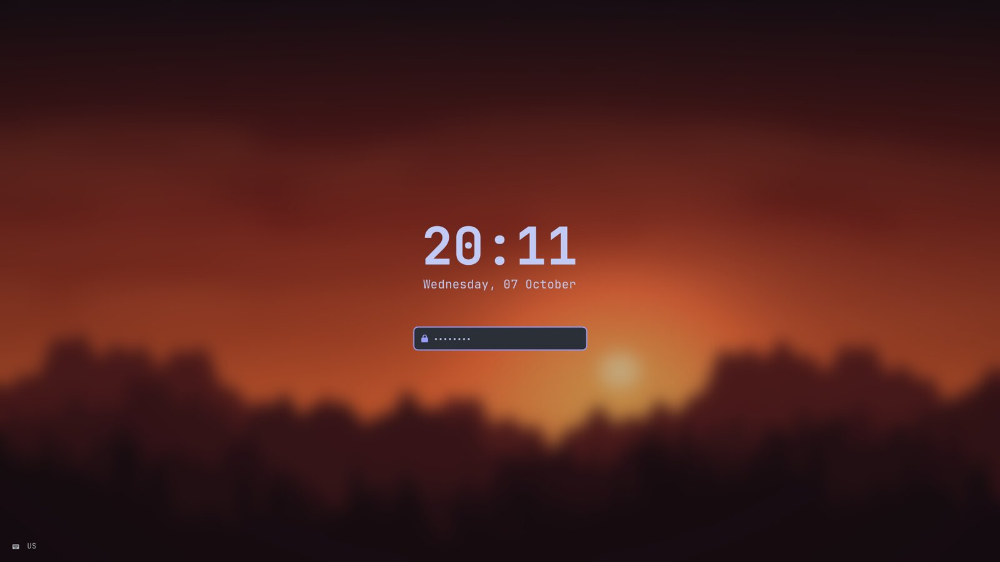

# bspwm-dots

bspwm для Arch Linux в стиле [ZProger/bspwm-dotfiles](https://github.com/Zproger/bspwm-dotfiles), собранный заново под текущий Arch: PipeWire, picom 12+, polybar 3.7, rofi 2, на выбор zsh, fish или bash, установщик на Python с вопросами и `debug.py` для типичных проблем.



| | |
|---|---|
| WM | bspwm + sxhkd |
| Бар | polybar |
| Композитор | picom: blur, скругления, анимации |
| Меню | rofi: приложения, калькулятор, эмодзи, буфер обмена, питание, Wi‑Fi |
| Уведомления | dunst |
| Терминал | alacritty |
| Оболочка | zsh, fish или bash + starship, fzf, zoxide, eza, bat |
| Редактор | neovim: lazy.nvim, mason, treesitter, blink.cmp |
| Вход | SDDM со своей темой |
| Блокировка | i3lock-dots (i3lock-color с точками и Caps Lock) + xss-lock |
| Файлы | Thunar, yazi |
| Браузер | Firefox с userChrome.css |

<p>


</p>

## Установка

Нужен установленный Arch с интернетом, хватит минимальной установки через `archinstall`.

```sh
su -c 'pacman -S --needed git python'
git clone https://github.com/Qwarwin4/bspwm-dots
cd bspwm-dots
su -c 'python install.py'
reboot
```

Установщик запускается от root, поэтому пароль по ходу не спрашивается. AUR-пакеты собираются от имени пользователя через временное правило в sudoers, которое удаляется сразу после сборки.

Что спрашивается:

- имя пользователя: под него пишутся конфиги, SDDM сразу предлагает его на экране входа; если такого нет, установщик создаст
- оболочка: zsh, fish или bash
- группы программ (Firefox, Thunar, mpv, Zathura, скриншоты, Telegram) и пакеты разработки (Neovim, C/C++, Python, Node, Rust, Go, Docker): номерами через пробел
- твики Firefox и Thunar, тема Dracula, AUR, обои ZProger
- раскладки (по умолчанию из локали, переключение Alt+Shift)
- батарея и адаптер питания: установщик сам проходит по `/sys/class/power_supply` и спрашивает, если их несколько
- подсветка и клавиши яркости: можно нажать клавиши, и установщик сам поймёт, что они присылают (`XF86MonBrightness`, `F3`/`F4` и т.п.)
- драйвер NVIDIA, если найдена видеокарта; автовход в SDDM

SDDM с темой ставится всегда, другой экран входа (ly и т.п.) отключается. Сами определяются микрокод, видео, виртуалка, bluetooth, мониторы и координаты для redshift по часовому поясу.

```
python install.py -h
  -u, --user NAME        пользователь, без вопроса
  -y, --yes              без вопросов, всё по умолчанию
      --shell zsh|fish|bash
      --no-aur
      --lock             только экран блокировки
      --flameshot        только скриншоты (flameshot)
```

Старые конфиги сохраняются в `~/.dots-backup/<дата>/`, лог лежит в `/var/log/bspwm-dots-install.log`. Повторный запуск ничего не ломает. Найденное железо записывается в `~/.config/bspwm/hardware`, его можно править руками.

## Если что-то не работает

```sh
python debug.py              # проверить всё и предложить исправления
python debug.py lock         # только блокировку: session lock brightness panel sddm system
python debug.py --fix        # исправить всё без вопросов
python debug.py --keys       # заново определить клавиши яркости нажатием
python debug.py --report     # отчёт в ~/bspwm-debug.txt
```

Запускать из-под пользователя в терминале сессии bspwm. Что требует root (сборка i3lock-dots, пакеты, SDDM), спросит пароль через sudo.

## Отдельные скрипты

Для уже настроенной системы есть самостоятельные скрипты, их можно скачать из Releases или собрать через `tools/bundle.sh`:

| Скрипт | Что делает |
|---|---|
| `switch-to-sddm.sh` | ставит SDDM с темой, отключает ly или другой DM, обновляет `wallpaper` и `lock` |
| `firefox-thunar-tweaks.sh` | твики Firefox и Thunar, тема и иконки Dracula |
| `lock-fix.sh` | экран блокировки: точки в поле пароля и Caps Lock |
| `flameshot-fix.sh` | скриншоты: flameshot 14 снимает экран напрямую через X11 |

```sh
chmod +x lock-fix.sh
./lock-fix.sh
```

Эти скрипты запускаются от обычного пользователя: права root попросят сами, через sudo или пароль root.

Внутри репозитория то же самое делают `scripts/sddm.sh`, `scripts/tweaks.sh` и `install.py --lock`: они запускаются только от root (`su -c ...`), у всех есть `-h`.

## Экран входа

Тема SDDM лежит в `sddm/bspwm-dots`. На фоне текущие обои, часы, дата, выбор сессии, раскладка и кнопки питания. Обои меняются вместе с рабочим столом: `wallpaper` кладёт копию в `/var/lib/bspwm-dots/user/background.jpg`, потому что SDDM не может читать домашнюю папку. Цвета, шрифт и затемнение настраиваются в `/usr/share/sddm/themes/bspwm-dots/theme.conf`.

Проверить тему без выхода из сессии:

```sh
sddm-greeter-qt6 --test-mode --theme /usr/share/sddm/themes/bspwm-dots
```

### ly

Если вместо SDDM нужен ly: `su -c ./scripts/ly.sh` настроит палитру консоли под цвета `~/.Xresources` (`/etc/vtrgb`, `vtrgb.service`) и тему ly в 16 цветах, с обоями полублоками или анимацией (`LY_ANIMATION=doom|matrix|colormix|gameoflife|none`). Сам ly ставится и включается вручную.

## Блокировка экрана

`Super + Shift + L`, а также сама после 15 минут простоя и перед сном. Фон из размытых текущих обоев, часы, дата и поле пароля в стиле экрана входа SDDM: подсказка «Пароль», точки при вводе, «Проверка...» и «Неверный пароль». Слева внизу раскладка и индикатор Caps Lock, он меняется сразу при нажатии. Перед блокировкой включается латиница.

На время блокировки picom выключается и после разблокировки запускается снова: с ним картинка блокировки замирала (часы стоят), а после гашения экрана оставался старый кадр рабочего стола при уже захваченном вводе.

Точки и Caps Lock даёт небольшой патч к i3lock-color (`pkgs/i3lock-dots`: исходники уже с патчем и запасной готовый бинарник). `scripts/i3lock-dots.sh` собирает его за пару секунд без интернета и без makepkg, а если сборка не вышла, ставит готовый. Результат — `/usr/local/bin/i3lock-dots` рядом с обычным i3lock, `lock` берёт его сам.

Только экран блокировки на уже настроенной системе: `su -c 'python install.py --lock'`, или `./lock-fix.sh` из Releases (это тот же установщик в режиме `--lock`). Что реально запустилось при последней блокировке, видно в `~/.cache/lock/last-run`, ошибки — в `~/.cache/lock/error.log`.

## Скриншоты

`Print` — область, `Shift + Print` — весь экран в буфер. Flameshot 14 по умолчанию снимает экран через xdg-desktop-portal, а у portal-gtk скриншотов нет, поэтому на bspwm он молча не работает. Установщик включает в `~/.config/flameshot/flameshot.ini` захват напрямую через X11 (`useX11LegacyScreenshot=true`), но только для 14 и новее: старые версии этот ключ не знают и встают с окном ошибки. Отдельно: `su -c 'python install.py --flameshot'` или `./flameshot-fix.sh`.

## Яркость

Клавиши яркости меняют её через systemd-logind, поэтому группа `video` не нужна. Какие клавиши и какая подсветка, установщик спрашивает сам; поменять потом: `python debug.py --keys` или руками в `~/.config/bspwm/hardware` и блоке `# brightness-keys` в `sxhkdrc`.

## Firefox и Thunar

Firefox: `user.js` (тёмная тема, пустая новая вкладка без рекламы, калькулятор в адресной строке) и `userChrome.css` из оригинала, переписанный под текущие переменные Firefox и палитру дотов. Применяется ко всем найденным профилям в `~/.mozilla/firefox` и `~/.config/mozilla/firefox`.

Thunar:
- действия в меню: терминал здесь, открыть в Neovim, сделать обоями, скопировать путь, открыть от root, поиск через fzf
- миниатюры, вид списком, папки сверху, закладки на XDG-папки
- плагины архивов и съёмных дисков
- GTK-тема Dracula-pink-accent и иконки dracula из оригинального репозитория, скачиваются при установке; отключается флагом `--no-dracula`

## Горячие клавиши

| Клавиши | Действие |
|---|---|
| `Super + Enter` | терминал |
| `Super + Shift + Enter` | плавающий терминал |
| `Super + D` | меню приложений |
| `Super + X` | меню питания |
| `Super + V` | история буфера обмена |
| `Super + C` | закрыть окно (`Super + Alt + C` — убить) |
| `Super + Space` | плавающее / тайлинг |
| `Super + F` | полноэкранный режим |
| `Super + T` / `Super + Ctrl + T` | tiled / pseudo-tiled |
| `Super + M` | monocle |
| `Super + H/J/K/L`, стрелки | фокус |
| `Super + Alt + H/J/K/L` | поменять окна местами |
| `Super + Ctrl + H/J/K/L` | размер окна |
| `Super + Shift + стрелки` | двигать плавающее окно |
| `Super + 1…0` / `Super + Shift + 1…0` | рабочий стол / перенести окно |
| `Super + Ctrl + 1…9` | предвыбор доли разделения |
| `Super + G` | поменять с самым большим окном |
| `Alt + Tab` | следующее окно |
| `Super + P` | скрыть / показать бар |
| `Super + W` | случайные обои |
| `Super + Shift + W` | Wi‑Fi |
| `Super + Shift + F` / `I` | Firefox / приватное окно |
| `Super + Shift + N` | Thunar |
| `Super + Shift + P` | pavucontrol |
| `Super + Shift + T` | Telegram |
| `Super + Shift + C` | калькулятор |
| `Super + Shift + E` | эмодзи |
| `Super + Shift + X` | пипетка (цвет в буфер) |
| `Super + Shift + L` | заблокировать экран |
| `Super + Shift + S` | btop |
| `Super + Shift + B` | bluetooth |
| `Super + Shift + M` | пересобрать мониторы и бар |
| `Print` / `Shift + Print` | скриншот области / всего экрана |
| `Super + Esc` | перечитать sxhkd |
| `Ctrl + Shift + R` / `Q` | перезапустить bspwm / выйти |
| `Alt + Shift` | раскладка |

Мультимедийные клавиши (громкость, микрофон, яркость, плеер) работают с уведомлением-ползунком.

## Под себя

- автозапуск: `~/.config/bspwm/autostart.local`
- своя схема мониторов: `~/.config/bspwm/screens`, иначе `autorandr`, иначе всё вправо от основного
- алиасы и переменные: `~/.zshrc.local`, `~/.bashrc.local`, `~/.config/fish/local.fish`, `~/.profile.local`
- цвета бара: `~/.config/polybar/colors.ini`
- батарея, адаптер, подсветка: `~/.config/bspwm/hardware`
- обои: `~/Pictures/wallpapers`, `Super + W` выбирает случайные

## Структура

```
install.py              установщик
debug.py                проверка и исправление проблем
pkgs/*.txt              списки пакетов, группы в [скобках] предлагаются на выбор
pkgs/i3lock-dots/       i3lock-color с патчем: исходники и готовый бинарник
home/                   всё, что копируется в $HOME
scripts/sddm.sh         SDDM и тема
scripts/tweaks.sh       Firefox и Thunar
scripts/i3lock-dots.sh  сборка i3lock-dots
scripts/ly.sh           палитра консоли и ly
sddm/bspwm-dots/        тема SDDM
firefox/                user.js и chrome/
thunar/                 действия и настройки Thunar
system/                 обои для ly
wallpapers/             обои по умолчанию
tools/bundle.sh         сборка отдельных скриптов в dist/
```

## Благодарности

- [ZProger/bspwm-dotfiles](https://github.com/Zproger/bspwm-dotfiles): исходный вид, набор обоев, тема и иконки Dracula
- [Dracula](https://draculatheme.com) GTK и иконки
- [Catppuccin](https://github.com/catppuccin) палитра терминала и neovim
